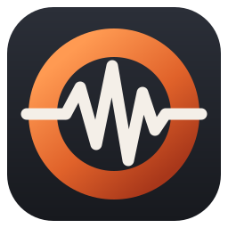
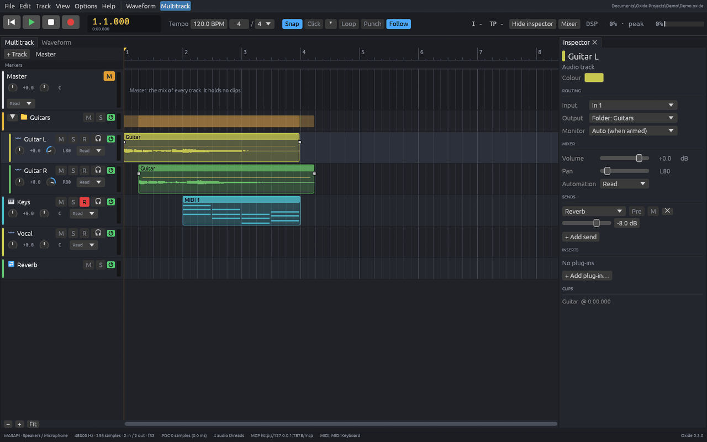
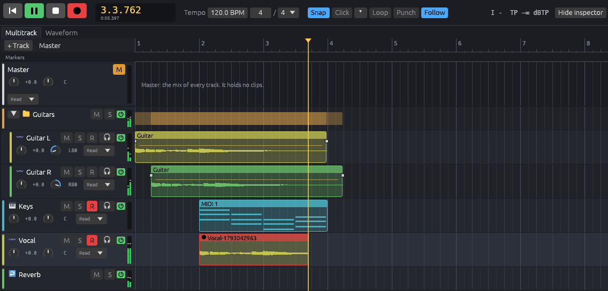
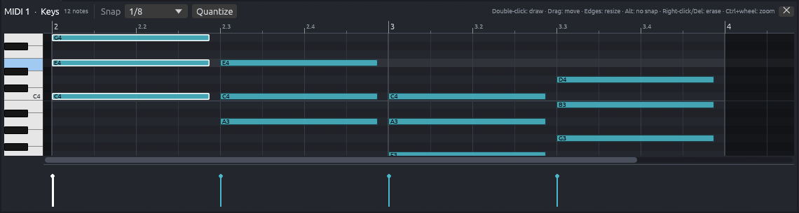
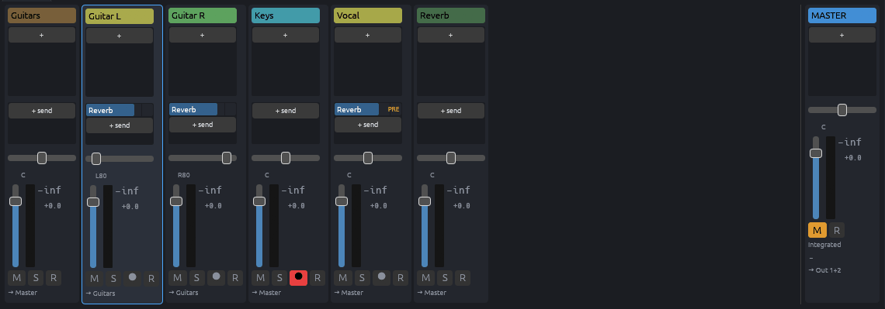
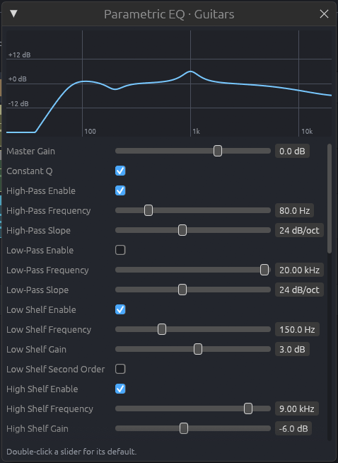
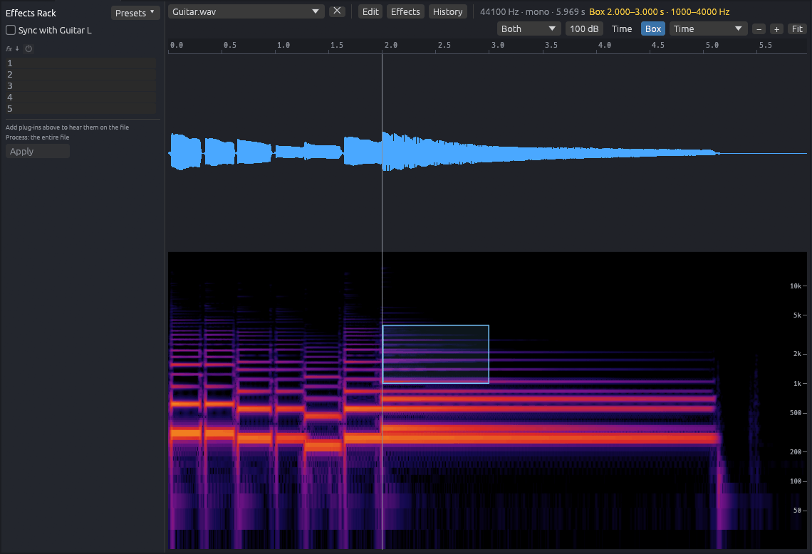
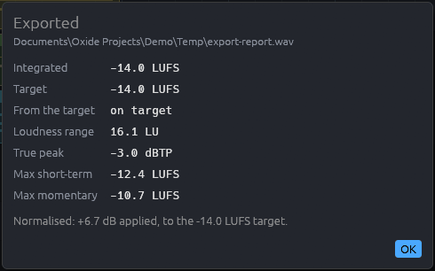

<h1 align="center">Oxide</h1>

A lightweight DAW for the bedroom and home musician. 
Record, edit, mix and master in one app.

  <a href="https://github.com/nubgamerz/Oxide/releases/latest"><b>Download</b></a> &nbsp;·&nbsp;
  <a href="docs/manual/">Manual</a> &nbsp;·&nbsp;
  <a href="CONTRIBUTING.md">Contributing</a>

  
  
  

Oxide keeps to what you need. Record your guitar, voice or a MIDI keyboard, edit and arrange it,
mix it, finish the result and export it, all in one program, without switching apps or wading
through a wall of options. It stays simple and responsive, and gives you the controls you
actually reach for.

## What it's like to use

- **Simple and responsive.** Focus on what matters when it comes to making your music. No need
  to worry about overly complex options. Expect a responsive DAW while being able to monitor
  your CPU usage and make necessary adjustments to compensate as your project grows.
- **What you hear is what you export.** A bounce runs through the same engine, the same plug-in
  instances and the same block size as playback, so the file sounds exactly like what you
  heard. Nothing is added unless you ask for it.
- **Built for heavy plug-ins.** Amp sims and mastering plug-ins across many tracks are what it
  is tuned for: tracks are mixed in parallel, and a processing block lets a driver with tiny
  buffers (and the low latency that goes with them) run big plug-ins without dropouts.
- **One app from first take to master.** The Multitrack is for recording and arranging; the
  Waveform view is for editing and finishing a single file. Switch between them with a click.

## What you can do

### Record

- Record guitar, voice or a MIDI keyboard on as many tracks as you like, with monitoring through
  your plug-ins while you play.
- Count-in, metronome, punch in and out, and loop recording that keeps every pass as a take.

*Recording: Keys and Vocal armed, Vocal's take growing in red under the playhead, the track meters lit.*

### Edit and write MIDI

- Cut, move, trim, fade and crossfade clips; a grid with snap; markers and a tempo map.
- Stretch or transpose a clip, or slice it at its transients.
- Draw, move and resize notes, set velocities, quantize and split clips.
- Import and export MIDI files, and play any instrument plug-in from a keyboard.
- Undo and redo, and autosave and backups so a crash costs you little.

*The piano roll on a Keys clip: chords with their note names, Snap on 1/8, Quantize, the keyboard and the velocity lane.*

### Mix

- A mixer with faders, pan, mute and solo; folders for sub-mixes and buses with sends for
  shared reverbs and delays.
- VST3 plug-ins on every track and on the master, with their delay compensated for you.
- Automation lanes for volume, pan, sends and plug-in parameters, with Read, Touch, Latch and
  Write modes.
- A loudness meter on the master (LUFS, true peak and loudness range).

*The mixer: a strip for the Guitars folder, Guitar L and R, Keys, Vocal and a Reverb bus, with sends to the reverb, pans, faders and the master strip.*

### Built-in effects

- Equalisers, a compressor, limiter and de-esser, reverbs, delays, chorus, flanger and phaser.
- Noise, hiss and hum reduction, plus click and clipping repair for cleaning up a recording.

*The built-in Parametric EQ, with its curve.*

### Finish and export

- The Waveform view: edit a file sample by sample, see its spectrogram, repair problems, run an
  effects rack over it and write the result.
- Export WAV, AIFF, FLAC, MP3 or Ogg Vorbis, with dither, sample-rate conversion and tags and
  cover art, optionally normalised to a loudness target.
- Render or switch off a heavy track to save CPU, and mix a whole project down to one file.

*The Waveform view on a guitar recording: the waveform and its spectrogram, with a box selected for spectral repair.*

*An export's report: integrated loudness of -14 LUFS on a -14 target, true peak -3 dBTP, normalised by +6.7 dB.*

## Getting started

You need 64-bit Windows (Oxide is developed and tested on Windows 11) and, if you use them,
VST3 plug-ins. Oxide plays and records through WASAPI or ASIO, so any audio interface Windows
can use will do.

1. **Install.** Download `Oxide-Setup-<version>.exe` from the
   [latest release](https://github.com/nubgamerz/Oxide/releases/latest) and run it. It installs
   for your account only (no administrator), and running a newer installer later updates it in
   place, keeping your settings. The installer isn't code-signed yet, so Windows SmartScreen may
   ask once: choose **More info**, then **Run anyway**.
2. **Open the manual.** Help > Manual opens it in your browser, and F1 opens the page about the
   part of Oxide you are pointing at. It is searchable, works offline, and has pictures with the
   parts they talk about outlined.
3. **Make a first project.** The start screen offers New project and Open; the manual's
   "Getting started" chapter takes you through a first recording.

### Your first song

1. **Install and start Oxide** as above. The start screen is where you begin.
2. **Create a project.** Type a name, pick a folder and press **Create project**. Oxide makes a
   folder that holds the project and everything it records or imports, so you can copy it
   anywhere.
3. **Pick your audio device.** Open Options > Settings…, choose **Audio**, select your
   interface's driver and device, and press **Apply**.
4. **Record.** Click **+ Track** and choose **Audio track**, set its **Input** in the inspector
   to where your guitar or microphone is plugged in, click its **R** button to arm it, then
   press the round Record button (or **R**) and play. Press **Space** to stop.
5. **Add effects.** Select the track and use **+ Add plug-in…** in the inspector to add a VST3
   plug-in or one of Oxide's built-in effects.
6. **Export.** Choose File > **Export mixdown…**, pick a format, and press **Export…**.

Each step has a page in the manual (Help > Manual, or F1), and building from source is covered
in [docs/DEVELOPMENT.md](docs/DEVELOPMENT.md).

## Built for AI from the ground up (MCP)

Oxide was designed with an [MCP](https://modelcontextprotocol.io) server inside it from the
start, so an AI assistant such as Claude can work alongside you. It can read the project, look at
the window, and do anything you can do: add tracks, write a MIDI part, set levels, load plug-ins,
export a mix. There is no separate "AI mode": each of Oxide's roughly 170 actions runs through
the same code as the menus and buttons, and its edits to your project are undo steps you can
take back, just like yours.

- **One-click setup.** Options > AI control (MCP) > Connect Claude sets up Claude Code and
  Claude Desktop for you.
- **Always listed.** Claude still lists Oxide's tools while Oxide is closed, and they work as soon
  as you start it.
- **Local only.** The server listens on your computer, and an optional token locks it down
  further.
- **Documented and tested.** The manual describes every action, with an example that the tests
  run, and the `write_midi_part` prompt walks Claude through writing a part that fits your song.
- **It can look things up.** An agent can search the manual itself (`search_manual`) and show
  you the page that answers your question.

## Licence

Oxide is free software under the [GNU General Public License v3](LICENSE): you may use it for
anything (at home, on stage, in the studio, for paid work), change it and share it, as long as
what you share stays under the same licence with its source. **The music you make with it is
yours**, to release and sell as you like; the licence doesn't cover it. The name "Oxide" and its
logo aren't licensed: a changed version must go by another name ([NOTICE](NOTICE)).
Oxide bundles third-party components under their own licences, listed in `THIRD-PARTY.txt`
beside the program.

## More

- Bug reports, ideas and pull requests: [CONTRIBUTING.md](CONTRIBUTING.md)
- The manual's sources: [docs/manual/](docs/manual/)
- Building, releasing and checking Oxide, and the full list of what works:
  [docs/DEVELOPMENT.md](docs/DEVELOPMENT.md)
